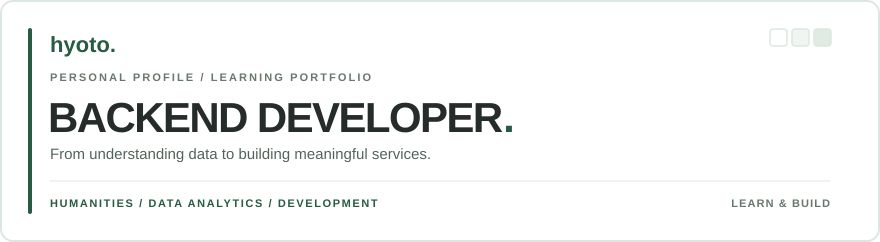

  

## About

인문학적 사고와 데이터 분석 학습 경험을 바탕으로, 데이터를 이해하고 문제를 구조화해 실질적인 서비스로 구현하는 백엔드 개발자를 지향합니다.

SSAFY 16기에서 Java와 Spring을 중심으로 개발 역량을 쌓고 있습니다.

## Tech Stack

> 학습한 기술과 활용 도구

| 분야 | 기술 |
| :--- | :--- |
| Languages | Java · Python · SQL |
| Backend | Spring |
| Database | Oracle · MySQL |
| Data &amp; Analytics | Tableau |

## Education

**SSAFY** · 삼성청년SW·AI아카데미 16기  
Software Development

**아이티윌** · 빅데이터 분석 전문가 양성 과정 51기  
Big Data Analytics

**숭실대학교** · 사학과 졸업  
History

## Selected Projects

**HomeFit**  
서비스 개발 프로젝트

**Data Analytics**  
데이터 분석 프로젝트

## Learning Archive

- [Algorithm Study](https://github.com/hyoto-927/algorithm_study) — Java 알고리즘 학습 기록

---

hyoto. &nbsp;·&nbsp; Learn deeply. Build meaningfully.

