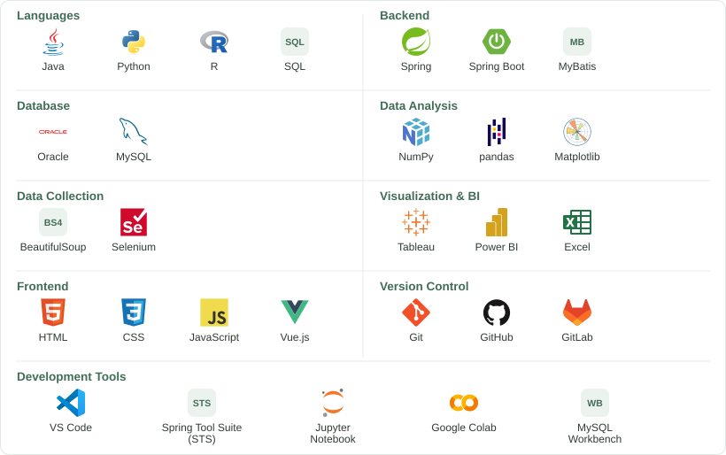

# 황효원

데이터 분석과 소프트웨어 개발을 공부하고 있습니다. 팀 프로젝트에서는 판매자가 먼저 대응할 고객 불만을 고르고, 세입자가 이사할 동네의 주거 지표를 비교할 수 있도록 데이터를 분석했습니다.

## 대표 프로젝트

### Olist 이커머스 리뷰 분석

**3인 팀 · 판매자 평점 분석 담당(Part 2)**

판매자가 어떤 고객 불만에 먼저 대응할지 판단할 수 있도록 리뷰 평점과 주문 거래액을 함께 분석했습니다. 배송 지연이 줄어들 때 저평점 위험에 노출되는 거래액의 변화를 추정하고, 같은 상품군의 평점 등급별 평균 거래액을 기준으로 기대매출 시나리오를 계산했습니다.

[분석 결과](https://github.com/hyoto-927/olist-review-analytics) · [시나리오 계산 예제](https://github.com/hyoto-927/olist-review-analytics/blob/main/tools/scenarios.py)

### AI 기반 주거 안정 프로젝트 · HomeKeeper

**5인 팀 · 외부 자료 수집과 모델링 참여**

팀원들과 수도권 실거래가와 생활 인프라를 법정동별로 비교하는 지도를 만들었습니다. 국회의원 사무실에도 자료 협조를 요청했지만 계약별 피해 여부를 확인할 수 없어, 전세사기 분류는 실거래가 분포를 반영한 가상 계약으로 실험했습니다.

[지도와 분석 과정](https://github.com/hyoto-927/HomeKeeper) · [모델 평가와 한계](https://github.com/hyoto-927/HomeKeeper/blob/main/docs/model-evaluation.md)

## 개발과 학습

- [Java 알고리즘 학습 기록](https://github.com/hyoto-927/codetree-java) · CodeTree
- **HomeFit** · 서비스 개발 프로젝트 (비공개 저장소)

## 교육

- **SSAFY** · 삼성청년SW·AI아카데미 16기
- **아이티윌** · 빅데이터 분석 전문가 양성 과정 51기
- **숭실대학교** · 사학과 졸업

## 자격

사용해 본 기술과 도구 보기

